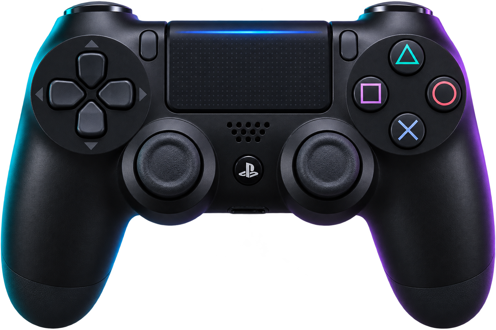

<div align="center">

# Touchpad PS4

### Seu controle. Seu mouse. Seu ritmo.

Transforme o touchpad do **DualShock 4** em uma extensão do Windows.




**Movimento preciso · Gestos naturais · Controle na bandeja**

[Recursos](#recursos) · [Executar](#executar-a-versão-desktop) · [Instalação UWP](#pacote-uwp) · [Validação](#estado-da-validação)

<sub>Imagem ilustrativa gerada para o projeto. Não é uma captura da interface nem material oficial da Sony.</sub>

</div>

---

## Uma janela para controlar tudo

A versão desktop moderna usa **WPF**, abre maximizada e mantém os controles nativos de minimizar, maximizar e fechar. O visual combina cartões translúcidos, tons escuros, detalhes ciano e uma imagem PNG do controle. Você pode redimensionar a janela, ajustar o movimento e ocultar o aplicativo na área perto do relógio.

O projeto também inclui uma interface **UWP com Acrylic** e um auxiliar desktop para executar o mouse em segundo plano.

> **Captura da interface: pendente.** O executável WPF foi compilado, mas o Windows bloqueou a execução da versão corrigida com a mensagem “Uma política de Controle de Aplicativo bloqueou este arquivo”. Nenhum mockup é apresentado como screenshot.

## Recursos

| Recurso | Como funciona |
| :--- | :--- |
| **Ativar e pausar** | Pela janela, pelo ícone da bandeja ou por `Ctrl + Alt + M`. |
| **Sensibilidade** | De **0,2× a 3×**, para ajustar o alcance do cursor. |
| **Velocidade extra** | De **0% a +200%** em gestos rápidos, preservando a precisão dos lentos. |
| **Clique por toque** | Um toque rápido executa o clique esquerdo. |
| **Botão direito** | Segure `L1` e toque ou pressione o touchpad. |
| **Rolagem** | Deslize dois dedos pelo touchpad. |
| **Área de notificação** | Mantenha o aplicativo ativo ao minimizar ou fechar a janela. |
| **Preferências salvas** | Seus ajustes persistem; um botão restaura o movimento padrão. |

> **Seu mouse continua igual.** Os ajustes são aplicados apenas aos movimentos gerados pelo controle. O aplicativo não altera velocidade, aceleração ou outras preferências do mouse do Windows. Os dois dispositivos controlam o mesmo cursor.

## Executar a versão desktop

**Destino:** Windows desktop 10/11 x64, com .NET Framework 4.8. A bandeja e os eventos de mouse usam APIs Win32. A aparência nativa da moldura varia conforme o Windows; o conteúdo usa o visual de vidro desenhado em WPF.

No Windows PowerShell, a partir da pasta do projeto:

```powershell
powershell.exe -NoProfile -ExecutionPolicy Bypass -File .\Desktop\Build.ps1
```

Abra `Desktop\bin\TouchpadPS4.exe`. Mantenha **MainWindow.xaml** e **dualshock4.png** ao lado do executável; o script já copia esses arquivos. Não há download binário ou instalador pronto publicado neste repositório.

### Usar no dia a dia

1. Conecte o DualShock 4 por USB ou pareie por Bluetooth.
2. Abra o aplicativo e escolha **Ativar touchpad**.
3. Ajuste sensibilidade e velocidade conforme sua preferência.
4. Use **Ocultar na bandeja** para deixar a janela fora do caminho.
5. Para reabrir, dê dois cliques no ícone perto do relógio. Para encerrar o motor, escolha **Sair** no menu do ícone.

Com **Manter ativo ao fechar a janela** ligado, minimizar ou fechar oculta a janela e mantém o motor ativo. Sem essa opção, fechar encerra o aplicativo. O Windows decide se o ícone aparece diretamente ou dentro da seta de ícones ocultos.

## Pacote UWP

Abra [`UWP/TouchpadPS4.sln`](UWP/TouchpadPS4.sln) no Visual Studio com ferramentas C# UWP e Windows SDK **10.0.19041.0**. Para gerar a distribuição assinada localmente:

```powershell
cd UWP
powershell.exe -NoProfile -ExecutionPolicy Bypass -File .\Build-Installer.ps1
```

O script prepara a pasta `Installer` com pacote APPX, dependências, certificado público e scripts de instalação. O certificado autoassinado destina-se à distribuição local e precisa ser conferido e aceito no computador de destino. A chave privada não é distribuída.

A interface UWP usa um componente **full-trust Win32** para bandeja, atalho global e acesso contínuo ao controle. O pacote tem como destino Windows desktop 10 1809+ e Windows 11 x64; não é uma versão para Xbox.

Consulte o [guia UWP](UWP/README.md) para os detalhes de assinatura e instalação.

## Estado da validação

| Item | Situação |
| :--- | :--- |
| Motor e auxiliar de bandeja | Compilados localmente. |
| Gestos e ajustes de movimento | **12 testes automatizados aprovados**, com eventos registrados em memória. |
| Interface WPF moderna | Compilada. Um erro de layout encontrado na primeira abertura foi corrigido; a execução posterior foi bloqueada pelo Controle de Aplicativo do Windows. A interface corrigida ainda precisa de validação visual. |
| Interface e pacote UWP | Não compilados nesta máquina; faltam as ferramentas UWP. |
| Controle físico e instalação em outros PCs | Ainda precisam de validação. |
| Screenshot da janela moderna | Pendente da abertura do aplicativo. |

Para verificar o motor sem movimentar o mouse real:

```powershell
powershell.exe -NoProfile -ExecutionPolicy Bypass -File .\UWP\Build-Tray.ps1
powershell.exe -NoProfile -ExecutionPolicy Bypass -File .\UWP\Test-Engine.ps1
```

## Por dentro do projeto

```text
Desktop/                Interface WPF moderna e script de compilação
UWP/                    Interface UWP e scripts de instalação
  Tray/                 Motor HID, bandeja e testes
assets/                 PNG do controle e informações da imagem
App.cs / AppEngine.cs   Protótipo original Windows Forms
ds4-touchpad-mouse.ps1   Protótipo original em PowerShell
ds4tm.cs                Motor do protótipo PowerShell
```

As interfaces modernas compartilham o motor de `UWP/Tray/Engine.cs`. Os protótipos originais foram preservados e não receberam as correções desse motor. Compilados, certificados e preferências locais ficam fora do Git.

---

<div align="center">
<sub>Projeto independente. PlayStation e DualShock são marcas de seus respectivos titulares. Sem afiliação com a Sony.</sub>
</div>
